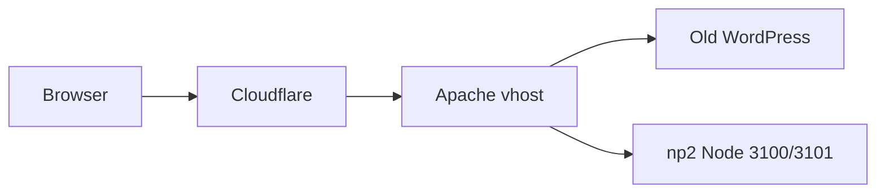

# NewsPoint 2.0 — cutover preparation and go-live runbook

2026-10-17. Prepare maximum work **before** replacing the live WordPress site on `https://newspoint.bg`, without interrupting the old site until an explicit cutover evening (budget **1–2 hours**). Canonical host: **apex** `https://newspoint.bg` (`www` redirects to apex).

Primary technical references:

- [docs/CUTOVER_AUDIT.md](./CUTOVER_AUDIT.md) — latest read-only audit (2026-10-17)
- [deploy/np2/CLOUDFLARE.md](../deploy/np2/CLOUDFLARE.md) — ingress, SSL, cache, indexing, verification
- [deploy/np2/APACHE_FLIP.md](../deploy/np2/APACHE_FLIP.md) — vhost switch + rollback
- [deploy/np2/cloudflare-cache-rules.md](../deploy/np2/cloudflare-cache-rules.md) — NP2 cache expressions
- [deploy/np2/cloudflare-proxies.txt.example](../deploy/np2/cloudflare-proxies.txt.example) — trusted CF IPs
- [deploy/np2/cloudflare-origin.conf.example](../deploy/np2/cloudflare-origin.conf.example) — `mod_remoteip` template
- [docs/SEO_PLAN.md](./SEO_PLAN.md) — indexing and discovery alignment

**Constraints (AGENTS.md):** do not modify the old WordPress account/files; production DNS flip, Cloudflare production rule changes at cutover, and `NP_PUBLIC_INDEXING=1` rebuild remain **explicit operator actions**. No API tokens or passwords in chat; Cloudflare MCP OAuth if used.

---

## Confirmed baseline

| Check | Result |
|--------|--------|
| SSH key | `%USERPROFILE%\.ssh\np2_newspoint` |
| SSH | `np2@95.217.114.220:6543` — OK (`server.newspoint.bg`) |
| NP2 app on server | `/home/np2/newspoint-app` exists |
| np2 ingress | `~/public_html/.htaccess` (updated 2026-10-17) |
| Apache cutover | Koce has spanel/root access |
| Pre-production rehearsal | Minimal (localhost smoke on server); rollback plan required |

---

## Cloudflare DNS (no IP change at cutover)

Snapshot from dashboard 2026-10-17:

- **A** `@`, `www`, `*` → `95.217.114.220`, **Proxied** (orange cloud)
- **MX** `mail.newspoint.bg` — **DNS only**
- **TXT** Google site verification (×2) — **DNS only**
- Follow-up (not blocking web cutover): **SPF**, **DMARC** (dashboard recommendations)

**Cutover does not move DNS.** Traffic stays same IP → Cloudflare → Apache; the switch is **which app Apache serves** for `@` / `www`, plus cache/SSL/indexing steps below.

---

## SSL/TLS snapshot

- Current mode: **Full** (not Full strict)
- Target: **Full (strict)** after a **valid origin certificate** for `newspoint.bg` on Apache ([CLOUDFLARE.md](../deploy/np2/CLOUDFLARE.md))
- May enable strict after cert smoke test; often safe while WP still live on same host/cert

---

## Current cache rule (WordPress — keep until cutover)

**Name:** Cache public WordPress pages · **Order:** First · **Status:** keep **Active** until cutover evening.

**Expression:**

```
(http.request.method in {"GET" "HEAD"}
 and http.request.uri.query eq ""
 and not starts_with(http.request.uri.path, "/wp-admin")
 and http.request.uri.path ne "/wp-login.php"
 and http.request.uri.path ne "/xmlrpc.php"
 and http.request.uri.path ne "/wp-cron.php"
 and not starts_with(http.request.uri.path, "/wp-json")
 and not (http.cookie contains "wordpress_logged_in_")
 and not (http.cookie contains "comment_author_"))
```

**Actions:** Eligible for cache · Edge TTL **2 minutes**, **ignore origin Cache-Control** · Browser TTL **Bypass**

Do **not** disable this rule during prep — it would change live WP behaviour.

---

## NP2 cache rules (prepare copy-paste; enable only at cutover)

After cutover, **disable/delete** the WordPress rule, then add (order matters):

### Rule 1 — Bypass NP2 dynamic and API (First)

**Action:** Bypass cache

**Suggested expression (review in dashboard):**

```
(
  starts_with(http.request.uri.path, "/api")
  or starts_with(http.request.uri.path, "/admin")
  or http.request.uri.path eq "/settings"
  or http.request.uri.path eq "/offline"
  or starts_with(http.request.uri.path, "/search")
  or starts_with(http.request.uri.path, "/_next/data")
  or any(http.request.headers["rsc"][*] eq "1")
  or any(http.request.headers["next-router-prefetch"][*] eq "1")
)
```

### Rule 2 — Static assets (Second)

**Match:** `starts_with(http.request.uri.path, "/_next/static")` (add `/brand/` if served under that prefix)

**Action:** Eligible for cache · Edge TTL **Respect origin**

### Rule 3 — Public media (Third)

**Match:** `starts_with(http.request.uri.path, "/media/")`

**Action:** Eligible for cache · Edge TTL **Respect origin** (do not override Cache-Control; Range requests)

**Default for HTML:** no “cache all public pages” rule — Cloudflare respects origin `private` / `no-store` from Next.

**After enabling:** Caching → **Purge Everything** (or targeted); verify `/api/live` SSE and `/admin` are not cache HIT.

---

## What changes when vs what stays

| Setting | Before cutover (WP live) | Cutover window (1–2 h) |
|---------|--------------------------|-------------------------|
| DNS A / MX / TXT | **No change** | **No change** |
| WP cache rule | **Active** | Disable/delete |
| NP2 cache rules | Documented only | Enable + purge |
| SSL Full → Full strict | After origin cert (optional before flip) | Verify; fix 525 if any |
| Apache `@` / `www` vhost | WP document root | Proxy to `127.0.0.1:3100` / `:3101` |
| `NP_PUBLIC_INDEXING` | **0** on server builds | **1** then rebuild/restart |

---

## Phase A — Prep (no user-visible change)

- [ ] Read-only SSH audit: `.htaccess` vs [render-ingress.mjs](../deploy/np2/render-ingress.mjs), Node on `:3100`/`:3101`, env flags (no secret values in logs)
- [ ] Backup **current WordPress vhost** config; write flip + **rollback** steps (< 5 min restore)
- [ ] Origin TLS cert for `newspoint.bg`; `mod_remoteip` on **np2 vhost** + [Cloudflare IP list](https://www.cloudflare.com/ips/) in trusted proxy file
- [ ] np2 deploy with `WEB_URL=https://newspoint.bg`, `STUDIO_PUBLIC_URL=…/admin`, **`NP_PUBLIC_INDEXING=0`**
- [ ] Server smoke: `curl -sI -H "Host: newspoint.bg" http://127.0.0.1:3100/`
- [ ] NP2 cache rules ready in this doc; **do not** touch WP cache rule
- [ ] Optional: `www` → apex redirect rule at edge (usually safe before cutover)
- [ ] Cutover runbook printed or offline copy for the evening

**Direct origin lockdown** (only Cloudflare IPs + admin): prefer **after** cutover or inside the maintenance window.

---

## Phase B — Cutover evening (explicit “go” only)

| Time | Action |
|------|--------|
| T−30 | Confirm WP vhost backup; np2 processes healthy |
| T0 | Apache **flip** `newspoint.bg` / `www` → np2 proxy; `apachectl configtest && reload` |
| T+10 | HTTPS smoke: home, article, `/admin/login`, `/api/live` (SSE) |
| T+15 | Cloudflare: disable WP cache rule → enable NP2 rules → **Purge** |
| T+20 | SSL **Full (strict)** if not already |
| T+25 | Set `NP_PUBLIC_INDEXING=1` in server `.env.local` → [remote-deploy.sh](../deploy/np2/remote-deploy.sh) / authorized restart |
| T+45 | Full [CLOUDFLARE.md](../deploy/np2/CLOUDFLARE.md) release verification + [SEO_PLAN.md](./SEO_PLAN.md) spot checks (canonical, sitemap, robots) |
| Buffer | If not stable within ~30 min: **rollback Apache to WP vhost**, re-enable WP cache rule, purge |

Do **not** delete WordPress files the same evening; only stop `@` traffic to WP.

---

## Phase C — After cutover

- Monitor 24–48 h: 5xx, LivePoint SSE, Studio publish, media Range, Search Console fetch
- SPF/DMARC for mail (separate from web launch)
- Refresh Cloudflare trusted proxy IP list on a schedule

---

## Architecture (current vs target)



Today `@`/`www` → oldWP. After flip → np2 only (WP idle on disk).

---

## Risks

- **Apache flip** is the user-visible switch — only in the cutover window; rollback snippet mandatory
- **Minimal preprod** increases cutover risk — mitigated by localhost smoke and fast WP rollback
- **`NP_PUBLIC_INDEXING=1`** requires rebuild; do not enable before go-live evening
- SEO: purge stale edge cache after indexing/header changes

---

## Next steps (implementation)

1. Execute **Phase A** prep (SSH audit, runbook details, cache expressions) — no CF/WP cache changes
2. Optional: Cloudflare MCP OAuth in Cursor for dashboard/API assist
3. Koce: origin cert + remoteip when convenient
4. Schedule cutover evening; start **Phase B** only on explicit **“go cutover”**
